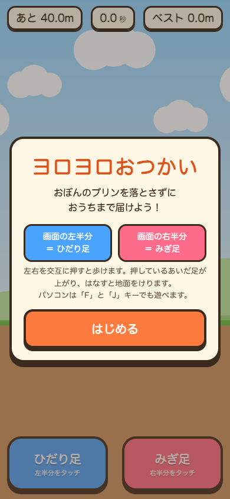
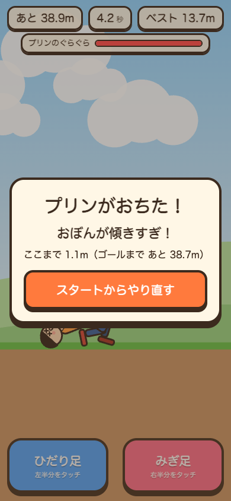

# ヨロヨロおつかい

左右の足を交互にタッチして、おぼんのプリンを落とさずに「おかしや」から「おうち」まで届けるゲームです。
海外で人気の「操作がむずかしい系」ゲーム（QWOP・Human: Fall Flat・Baby Steps）の良いところだけを組み合わせたオリジナル作品です。

| タイトル | プレイ中 | 失敗 |
|---|---|---|
|  |  |  |

## 遊び方
- 画面の左半分をタッチ＝ひだり足、右半分＝みぎ足（パソコンは F と J キー）
- 押しているあいだ足が上がり、はなすと地面をけります。左右を交互にリズムよく。
- ガクガク歩くと「プリンのぐらぐら」メーターがたまり、満タンでプリンが飛んでいきます。
- **リズムが大事**：同じ足を続けて押す・前の1歩と間かくが大きくずれる（あせる／もたもた）と体がぐらつき、続くと転びます。何も押さずに止まっている（はじめは約0.8秒、先へ行くと約0.7秒。最初の1歩は約1.7秒〜1.3秒）と、ぐにゃっと転びます。
- **体を保つ力**：リズムよく足ぶみして前に進んでいるあいだだけ、体を保てます。ボタンを押さない・前に進まない（じゃまな物にひっかかる等）・足を出さないと、体を保つ力がへって「ふらふら…」となり、そのまま転びます。はじめはゆっくりへり、先へ行くほど早くへります。リズムのずれの許しも、先へ行くほど小さくなります。
- **両方の足をいっしょに押して、はなすとジャンプ**。長く押すほど高く遠くへ飛びます。3軒目から道に「じゃまな物」（だんボール・植木ばち・コーン・ねているねこ）が出てくるので、ジャンプで越えます。
- **ころぶ（頭・体が地面につく／ひざをつく／しりもち・大きく倒れたまま）・プリンを落とす・穴に落ちる・時間切れで「ゲームオーバー」**（いつも最初のおかしやからやり直し）。次に待っている人（12人。何軒目かで変わる）が、悲しむ・あきれる・すねる・びっくり・怒る・泣く。セリフ・様子・プリンの種類の組み合わせで毎回ちがい、続けて失敗するほど怒ったり泣いたりしやすくなります。届けると喜びます。
- おうちごとに時間制限があります（1軒目は20秒。先へ行くほど少しずつきびしくなり、75秒前後で止まる）。のこり10秒で時計が赤くなり、5秒から音で知らせます。時間切れのときは「おそい！」系の反応になります。
- **レベルの区切りはなく、道がどこまでも続きます**。おうちにプリンを届けると、画面は止まらず、そのまま次のおうちへの道が続きます（上限なし）。画面の左上は「ここまで歩いたきょり」、右上は自己ベスト。ゲームオーバーまでに歩けたきょりで競います。
- **新しいしかけは決まったおうちで1つずつ登場**：3軒目「じゃまな物」・4軒目「段差」・5軒目「下り坂」・7軒目「ジャンプ台」（赤い台。乗るとピョーンと前へ飛ばしてくれる）・9軒目「穴」（ジャンプで越える。落ちたらゲームオーバー）。初めて出るところでは手前にやり方が出ます。11軒目からは「ジャンプ台で越える広い穴」も出ます。
- **6・16・26…軒目は「難関」**（しかけが4軒先の多さ）。そのすぐあと（17・27…軒目）は少しひと休み。
- **コースは毎回同じ**。おぼえれば上達します。ゲームオーバーまでに歩けたきょりの自己ベストをスマホに保存します。
- **じぶんの記録ランキング**：ゲームオーバーまでに歩けたきょりの上位10回を、このスマホの中だけに残します（ゲームオーバー画面とタイトルに表示。今回の記録は色つき）。ログインや名前の入力はいりません。
- **自己ベストの金色の旗**：道の上の自己ベストの場所に旗が立ちます。こえると「自己ベスト こえた！」と音で知らせ、右上のベストの数字も一緒にふえます。
- **ほめる表示**：左右をリズムよく10歩続けるごとに「ナイスリズム ×10」、50mごとに「50m とっぱ！」。
- **記録を送る**：ゲームオーバー画面の「記録を送る」で、歩いたきょりと待っている人のひとことを LINE などで送れます（送れないスマホではコピー）。
- **ひと休み**：遊んでいる途中でアプリを離れると止まり、もどったら「つづける」で再開します（音も止まる）。
- **リズムガイド**：次に押す足のボタンが光り、ボタンの上のバーに「いま押す」ところ（緑）が出ます。黒い線が緑のところに来たら押すと「いいリズム」（バーが緑に光る）。早すぎ・おそすぎは赤く光ります。緑の場所は、その人の前の1歩の間かくで決まります（速いテンポでも、おそいテンポでも、同じ間かくならOK）。
- **足の色**：左足は青、右足は赤のくつした（下のボタンと同じ色）。押している足は白く光り、地面には足の色の足あとが残ります。左足はいつも奥、右足はいつも手前にかくので、足が入れかわって見えません。
- **バランスメーター**：上の「バランス」は体を保つ力です。いいリズムの1歩でたまり、早すぎ・おそすぎ・同じ足・止まる・押さないとへります。赤くなると ふらふらして、なくなると転びやすくなります。
- **速さ**：いいリズムの1歩ごとに前へ進む勢いがつき、速く押すほど速く走れます（1秒に3歩で約1.6m/秒、7歩で約3m/秒）。リズムが続くとさらに速くなり（10歩ごとに「スピードUP！」）、速いときは体のうしろに線が出ます。いまの速さは「⚡」に出ます。
- **すぐもう一回**：ゲームオーバー画面は、ボタン以外のどこをタップしても すぐ最初から（出てから0.7秒は反応しません。歩いていた指でうっかり押さないように）。
- **あとちょっと表示**：ゲームオーバー画面に「ベストまで あと 2.3m！ おしい！」「4位まで あと 1.2m！」、ベストをこえたら「自己ベスト更新！ +3.1m」を大きく出します。
- **ずかん**（タイトル・ゲームオーバー画面の「📖 ずかん」）：ころび方9種・おたから10種・できごと4種・待っている人の顔（15人×7つの気持ち）を集めます。新しく入ると、ゲームオーバー画面に「NEW！」で出ます。まだ見ていないころび方はヒントが出ます。このスマホの中だけに残ります。
- **道のおたから**：道に「？」の箱があり、ぶつかると中身（あめ玉〜王かん。めずらしいものほど出にくい）が手に入ります。紫の箱は高いところにあり、ジャンプしないと取れません。
- **きせかえ**（タイトルの「👕 きせかえ」）：運ぶもの（プリン・おだんご・ショートケーキ・目玉焼き・スイカ・金魚ばち・金のプリン）と服（いつもの・赤ジャージ・黄色カッパ・パジャマ・にんじゃ・コックさん・王子さま）が、合計で歩いたきょり・自己ベスト・遊んだ回数・ずかんの数・れんぞく日数・おたからで使えるようになります。まだのものは「あと 34m」のように条件が出ます。待っている人のセリフも、運んでいるものの名前に変わります。
- **今日のコース**（タイトルの「📅 今日のコース」）：日付でコースの並び・風・お客さん・箱の場所が変わり、その日はだれが遊んでも同じコースです（難しさはいつもと同じ）。今日のベストと回数が残ります（じぶんの記録ランキングには入りません）。
- **れんぞく日数**：1日に1回でも遊ぶと「🔥 3日 れんぞく」のようにふえます。1日あけると1からです。
- **転んだ動画**：ゲームオーバー画面の「🎬 転んだところを動画にする」で、さいごの4秒＋スローのくり返し＋待っている人のひとことの動画（約10秒）を作り、もう1回押すと LINE などで送れます（送れないときは保存）。動画が作れないスマホでは画像になります。
- **たまに起きる出来事**：3軒目からときどき「向かい風」「追い風」（体がおされる）、2軒目からごくたまに「めずらしいお客さん」（王さま・おばけ・うちゅう人）、ごくたまに「金のプリンの日」（プリンが金色・おたからが2ばい）。
- 難しさは終わりなく上がり続けます（先へ行くほど、リズムの許し・体を立て直す手助け・坂・段差・じゃまな物・穴・時間がきびしく）。
- 音（足音・ジャンプ・着地・転ぶ・プリンが飛ぶ・旗・クリア・BGM）はすべてこのゲームのために作ったオリジナル。右上の 🔊 ボタンで消せます（iPhone はマナーモードだと鳴りません）。

## 見る場所
- スマホ：https://kensho-goto.github.io/yoroyoro-otsukai/ （`docs/qr-phone.png` を読み取る）
  - メンバー用の試作版なので、最初に合言葉「いいんじゃ」を入れる（カタカナ「イインジャ」・ローマ字「einja」でも可。一度入れたらそのスマホでは次から聞かれない）
  - 検索には出ない設定。main に push すると自動で新しくなる（`.github/workflows/pages.yml`）
- パソコン：このフォルダーで `npm start` → http://localhost:8123/

## 組み合わせた良いところ
| もとのゲーム | 取り入れた良いところ | 避けた悪いところ |
|---|---|---|
| QWOP | ボタン2つですぐ遊べる・転び方が笑える・記録を更新したくなる | むずかしすぎてすぐやめる |
| Human: Fall Flat | ぐにゃぐにゃの体・死なずにすぐやり直せる | 1人だとくり返しに感じる |
| Baby Steps | 足を1本ずつ動かす歩き方・少しずつ進む達成感 | 転ぶと大きく戻される・テンポがおそい |
| トニーくんのターザンジャンプ（レベルの上げ方だけ参考） | しかけを1つずつ足していく・ときどき難関がある・コースが毎回同じでおぼえて上達・通しきょりの記録 | 名前・キャラ・見た目・ステージ・音楽はまねしない |

## ファイル
- `src/core.js` 体の動き・コース・判定（難しさの数値は先頭の `TUNING`）
- `src/main.js` 画面の絵と操作
- `src/waiter.js` 待っている人（顔の絵・セリフの組み合わせ）
- `src/zukan.js` ずかん（集めたものの記録と、ずかん画面）
- `src/closet.js` きせかえ（運ぶもの・服と、使えるようになる条件）
- `src/days.js` 今日のコースと、れんぞく日数
- `src/clip.js` 転んだ動画（さいごの数秒を取っておき、動画にする）
- `src/rank.js` じぶんの記録ランキング
- `src/sound.js` 音（音のファイルは使わず、その場で作って鳴らす）
- `tools/` 自動で歩かせて難しさを確かめる道具（`npm run tune` / `npm run meter` / `npm run levels`＝レベルごとのゴールできる割合。`--nojump` でジャンプしない場合、`--from=20` で途中のレベルから）
