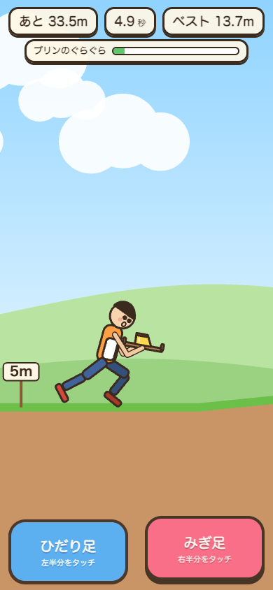

# ヨロヨロおつかい

左右の足を交互にタッチして、おぼんのプリンを落とさずに「おかしや」から「おうち」まで届けるゲームです。
海外で人気の「操作がむずかしい系」ゲーム（QWOP・Human: Fall Flat・Baby Steps）の良いところだけを組み合わせたオリジナル作品です。

| タイトル | プレイ中 | 失敗 |
|---|---|---|
|  |  |  |

## 遊び方
- 画面の左半分をタッチ＝ひだり足、右半分＝みぎ足（パソコンは F と J キー）
- 押しているあいだ足が上がり、はなすと地面をけります。左右を交互にリズムよく。
- ガクガク歩くと「プリンのぐらぐら」メーターがたまり、満タンでプリンが飛んでいきます。
- 旗を通ると、失敗しても旗のところからやり直せます。

## 見る場所
- スマホ：https://kensho-goto.github.io/yoroyoro-otsukai/ （`docs/qr-phone.png` を読み取る）
  - メンバー用の試作版なので、最初に合言葉「ぷりん」を入れる（カタカナ・ローマ字でも可。一度入れたらそのスマホでは次から聞かれない）
  - 検索には出ない設定。main に push すると自動で新しくなる（`.github/workflows/pages.yml`）
- パソコン：このフォルダーで `npm start` → http://localhost:8123/

## 組み合わせた良いところ
| もとのゲーム | 取り入れた良いところ | 避けた悪いところ |
|---|---|---|
| QWOP | ボタン2つですぐ遊べる・転び方が笑える・記録を更新したくなる | むずかしすぎてすぐやめる |
| Human: Fall Flat | ぐにゃぐにゃの体・死なずにすぐやり直せる | 1人だとくり返しに感じる |
| Baby Steps | 足を1本ずつ動かす歩き方・少しずつ進む達成感 | 転ぶと大きく戻される・テンポがおそい |

## ファイル
- `src/core.js` 体の動き・コース・判定（難しさの数値は先頭の `TUNING`）
- `src/main.js` 画面の絵と操作
- `tools/` 自動で歩かせて難しさを確かめる道具（`npm run tune` / `npm run meter`）
